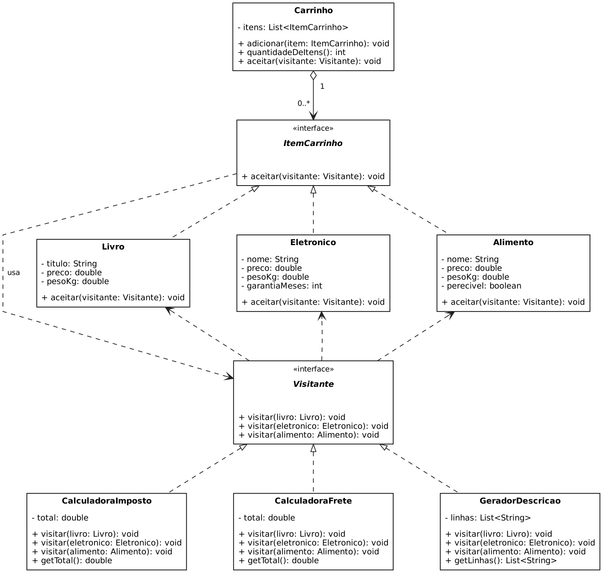

# Padrão de Projeto: Visitor

Trabalho da disciplina Arquitetura e Projeto de Software — implementação do padrão de projeto comportamental Visitor.

## O que o padrão resolve

O Visitor permite adicionar novas operações a uma estrutura de objetos sem alterar as classes desses objetos. Em vez de espalhar cada operação (calcular imposto, calcular frete, gerar descrição...) dentro de cada classe da estrutura, cada operação vira uma classe própria (o visitante) que sabe o que fazer com cada tipo de elemento. O elemento apenas "aceita" o visitante e se apresenta a ele (*double dispatch*), e o visitante decide o comportamento conforme o tipo recebido.

## Aplicação escolhida

Um carrinho de compras (`Carrinho`) com itens de tipos diferentes: `Livro`, `Eletronico` e `Alimento`. Sobre esses itens existem operações diferentes, cada uma implementada como um visitante:

- `CalculadoraImposto`: livro isento (0%), eletrônico 18%, alimento 7%;
- `CalculadoraFrete`: taxa e valor por quilo diferentes para cada tipo, com taxa maior para alimentos perecíveis;
- `GeradorDescricao`: monta uma linha de texto para cada item.

Para criar uma nova operação (por exemplo, calcular desconto), basta criar um novo visitante. Nenhuma classe de item precisa ser modificada.

## Estrutura do projeto

```
visitor-pattern/
├── src/
│   ├── main/java/com/univassouras/visitor/
│   │   ├── Visitante.java
│   │   ├── ItemCarrinho.java
│   │   ├── Livro.java
│   │   ├── Eletronico.java
│   │   ├── Alimento.java
│   │   ├── CalculadoraImposto.java
│   │   ├── CalculadoraFrete.java
│   │   ├── GeradorDescricao.java
│   │   ├── Carrinho.java
│   │   └── Main.java
│   └── test/java/com/univassouras/visitor/
│       └── CarrinhoTest.java
├── diagrama/
│   └── diagrama-classes-visitor.png
├── pom.xml
└── README.md
```

## Papéis do padrão nesta implementação

| Papel no padrão              | Classe neste projeto                                           |
|-------------------------------|------------------------------------------------------------------|
| Visitante (Visitor)           | `Visitante`                                                    |
| Visitantes concretos          | `CalculadoraImposto`, `CalculadoraFrete`, `GeradorDescricao`   |
| Elemento (Element)            | `ItemCarrinho`                                                 |
| Elementos concretos           | `Livro`, `Eletronico`, `Alimento`                              |
| Estrutura de objetos          | `Carrinho`                                                     |

## Como executar

Pré-requisitos: JDK 17+ e Maven (ou usar o Maven embutido do IntelliJ).

```bash
mvn compile exec:java -Dexec.mainClass="com.univassouras.visitor.Main"
```

A saída lista os itens do carrinho e mostra o total de impostos e o total de frete, calculados pelos dois visitantes sobre a mesma estrutura de itens.

## Como rodar os testes

```bash
mvn test
```

Os testes cobrem:
- imposto de cada tipo de item (livro, eletrônico e alimento);
- soma do imposto e do frete para um carrinho com todos os tipos de item;
- diferença de frete entre alimento perecível e não perecível;
- geração da descrição, uma linha por item e na ordem de inserção;
- cada item chamando o método `visitar` correspondente ao seu próprio tipo;
- carrinho vazio com totais zerados.

## Diagrama de classes



## Autor

Trabalho individual — disciplina Arquitetura e Projeto de Software.
